Діаграма показує, які сторінки в `app/[lang]/` викликають маршрути з `app/api/`, які сервіси ці маршрути отримують через `app/di/container.ts` і від яких репозиторіїв та моделей у `app/infrastructure/` залежать ці сервіси. Ребра є лише там, де виклик є в коді. Маршрути `collaboration` і `blob-url` сервісів не використовують: перший лише валідує форму, другий віддає файл із `public/`.

```mermaid
flowchart TD
  artistry["app/[lang]/artistry/page.tsx"]
  research["app/[lang]/research/page.tsx"]
  archive["app/[lang]/archive/page.tsx"]
  contacts["app/[lang]/contacts/page.tsx"]
  cooperation["app/[lang]/cooperation/page.tsx"]

  compFilters["app/api/compositions/filters/route.ts"]
  compData["app/api/compositions/data/route.ts"]
  compTitles["app/api/compositions/titles/route.ts"]
  blobUrl["app/api/blob-url/route.ts"]
  worksFilters["app/api/scientific-works/filters/route.ts"]
  worksData["app/api/scientific-works/data/route.ts"]
  worksTitles["app/api/scientific-works/titles/route.ts"]
  fundsRoute["app/api/funds/route.ts"]
  collaboration["app/api/collaboration/route.ts"]

  artistry --> compFilters
  artistry --> compData
  artistry --> compTitles
  artistry --> blobUrl
  research --> worksFilters
  research --> worksData
  research --> worksTitles
  archive --> fundsRoute
  contacts --> collaboration
  cooperation --> collaboration

  di["app/di/container.ts"]
  artistryService["app/services/artistry/artistryService.ts"]
  scientificWorks["app/services/scientific-works/scientificWorks.ts"]
  fundsService["app/services/funds/fundsService.ts"]

  compFilters --> di
  compData --> di
  compTitles --> di
  worksFilters --> di
  worksData --> di
  worksTitles --> di
  fundsRoute --> di
  di --> artistryService
  di --> scientificWorks
  di --> fundsService

  compositionsRepo["app/infrastructure/repositories/artistry/compositions.repository.ts"]
  scientificRepo["app/infrastructure/repositories/scientific-works/scientificWorks.repository.ts"]
  fundsRepo["app/infrastructure/repositories/funds/funds.repository.ts"]
  dbConnect["app/infrastructure/db/connect.ts"]
  publicDir["public/"]

  artistryService --> compositionsRepo
  scientificWorks --> scientificRepo
  fundsService --> fundsRepo
  blobUrl --> publicDir

  compositionsRepo --> genre["app/infrastructure/models/artistry/artistryGenreData.ts"]
  compositionsRepo --> categories["app/infrastructure/models/artistry/artistryCategoriesData.ts"]
  compositionsRepo --> opus["app/infrastructure/models/artistry/artistryOpusData.ts"]
  compositionsRepo --> compositions["app/infrastructure/models/artistry/artistryTableData.ts"]
  compositionsRepo --> dbConnect

  scientificRepo --> authors["app/infrastructure/models/scientific-works/scientificWorksAuthor.ts"]
  scientificRepo --> worksTable["app/infrastructure/models/scientific-works/scientificWorksTableData.ts"]
  scientificRepo --> dbConnect

  fundsRepo --> fund["app/infrastructure/models/archive/Fund.ts"]
  fundsRepo --> caseModel["app/infrastructure/models/archive/Case.ts"]
  fundsRepo --> document["app/infrastructure/models/archive/Document.ts"]
  fundsRepo --> dbConnect
```

