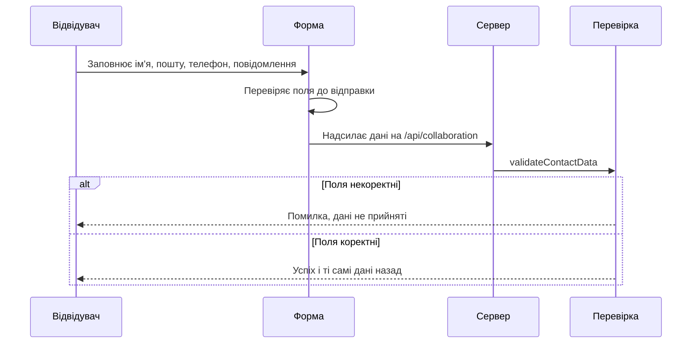

# Передзвон замість листа

Команда хоче передзвонювати людям, які залишили звернення, бо листи губляться. Зараз сайт приймає форму, але не зберігає її і не відправляє листа. Окремого сценарію передзвону в системі немає.

## User stories

Як співробітник фундації, я хочу передзвонювати людині, яка залишила звернення, щоб повідомлення не губилося разом із листом.

## Діаграма потоку

Так дані йдуть зараз. Бази (сховища звернень) на цьому шляху немає. Передзвон на діаграмі відсутній, бо його немає в коді.

## Правила

| ID | Правило | Де в коді |
| --- | --- | --- |
| BR-01 | Ім'я, пошта і повідомлення обов'язкові. Телефон можна не вказувати. | `ContactForm.tsx`, `validateContactData.ts` |
| BR-02 | Якщо телефон уведений, він має пройти перевірку формату. Порожній телефон не є помилкою. | `validateContactData.ts` |
| BR-03 | Після успішної перевірки сервер повертає ті самі дані. Він не записує звернення в базу і не викликає відправку листа. | `app/api/collaboration/route.ts` |
| BR-04 | Служба листів (`emailService`) існує, але форма її не викликає. Навіть прямий виклик лише готує текст листа і відповідає успіхом, листа не надсилає. | `app/services/email/emailService.ts` |
| BR-05 | Маршрут `/api/contact` перевіряє дані так само і теж нічого не зберігає. Форма на сайті його не викликає. | `app/api/contact/route.ts` |

## Acceptance Criteria

AC-01. Given відвідувач заповнив ім'я, коректну пошту і повідомлення, When він надсилає форму співпраці, Then сервер відповідає успіхом і повертає ці дані, не зберігаючи звернення.

AC-02. Given відвідувач не вказав телефон, When він надсилає форму з рештою коректних полів, Then це не є причиною відмови.

AC-03. Given відвідувач увів телефон у неприйнятному форматі, When він надсилає форму, Then сервер не приймає звернення.

AC-04. Given звернення прийняте сервером, When співробітник шукає, кому передзвонити, Then у системі немає збереженого списку звернень і немає кроку передзвону.

## Ключові файли

| Файл | Навіщо він у цій фічі |
| --- | --- |
| `app/shared/components/forms/contact-form/ContactForm.tsx` | Форма: які поля бачить відвідувач і що перевіряється до відправки |
| `app/shared/components/forms/offer-collaboration-form/OfferCollaborationForm.tsx` | Надсилає форму на сервер |
| `app/api/collaboration/route.ts` | Приймає звернення про співпрацю |
| `app/api/contact/route.ts` | Окремий приймач контактної форми; сторінка його не викликає |
| `app/lib/utils/validateContactData.ts` | Повторна перевірка полів на сервері |
| `app/services/email/emailService.ts` | Заготовка листа, без реальної відправки і без зв'язку з формою |

## Відкриті питання

Q-01. Передзвон замінює лист чи йде додатково до нього?

Q-02. Хто передзвонює і в який строк?

Q-03. Телефон зараз необов'язковий. Чи має він стати обов'язковим, якщо листи губляться?

Q-04. Які саме листи губляться: лист відвідувачу, лист команді чи обидва?

Q-05. Де має зберігатися звернення, щоб було з чого передзвонювати? Зараз воно ніде не записується.

Q-06. Що показати відвідувачу після відправки: що йому передзвонять, чи лише що форму прийнято?
