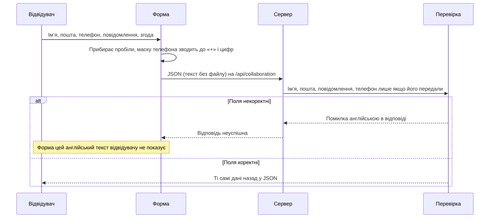

# Контактна форма

Відвідувач залишає звернення: ім’я, електронну пошту (адресу для листів) і повідомлення. Телефон зараз можна не вказувати, файлу додати не можна, а лист-сповіщення команді не надсилається. Запланована зміна робить телефон обов’язковим, додає необов’язковий PDF (тип документа) до 5 МБ і включає цей файл у сповіщення як посилання або завантаження.

## 1. Вихідний запит

Текст issue #2 дослівно:

> ## Original request
> We want to tighten up the contact form. Phone number should be mandatory.
> We should also let visitors attach a document (CV or portfolio) when they write
> to us. Notifications need to reflect the new field.

## 2. Бізнес-контекст

<!-- edited: прибрано ціль, метрику й NFR-1…NFR-4. Їх дав агент у ролі замовника і вони були позначені як непідтверджені. -->

Підтверджений запит замовника є лише в issue #2: обов’язковий телефон, документ (CV або портфоліо) і сповіщення, яке враховує нове поле. Цілі, метрики успіху й обмежень щодо приватності, строку зберігання та антивірусу замовник не називав.

Окремо в розмові про реалізацію сказано: телефон обов’язковий, файл необов’язковий, лише PDF до 5 МБ, у сповіщенні посилання або завантаження. Це не текст issue.

## 3. User stories

<!-- edited: прибрано вигадані вигоди «лист загубиться» і «без повторного листа». Залишено лише те, що є в issue #2 і в рішенні про реалізацію. -->

Як відвідувач сайту, я хочу вказати телефон у контактній формі, щоб він був частиною звернення.

Як відвідувач сайту, я хочу додати документ, CV або портфоліо, коли пишу до фундації, щоб він був у тому самому зверненні.

Як співробітник фундації, я хочу отримувати сповіщення з новим полем, щоб у ньому був телефон і, якщо файл додано, цей файл.

## 4. Діаграма послідовності

Так дані йдуть зараз. Бази (сховища звернень) на цьому шляху немає.

<!-- edited: на гілці помилки відвідувач не бачить англійський текст. Форма його не показує. -->

Сторінка контактів і блок співпраці надсилають форму на `/api/collaboration`. Маршрут `/api/contact` сторінки не викликають. Вікно нотаток показує ту саму форму і після натискання лише переходить до підтвердження.

## 5. Таблиця правил

Порожня клітинка означає, що цього немає ні в коді, ні в підтвердженій відповіді замовника.

| ID | Правило простою мовою | Є зараз | Має бути | Хто вирішив |
| --- | --- | --- | --- | --- |
| RULE-01 | Ім’я від 2 до 50 символів. У формі пробіли по краях прибираються. | так | | |
| RULE-02 | На сервері ім’я теж від 2 до 50 символів, але пробіли по краях не прибираються. | так | | |
| RULE-03 | Пошта у формі обов’язкова і перевіряється як адреса. | так | | |
| RULE-04 | На сервері пошта перевіряється іншим шаблоном, ніж у формі. | так | | |
| RULE-05 | Повідомлення від 10 до 1000 символів. | так | | |
| RULE-06 | Телефон можна не вказувати. | так | обов’язковий | замовник, issue #2 |
| RULE-07 | Якщо телефон передали, він має бути від 11 до 16 символів: «+» і цифри. | так | | |
| RULE-08 | У формі номер маскується за списком кодів країн. Хибний код або довжина блокують відправку. | так | | |
| RULE-09 | Перед відправкою маска стає «+» і цифрами. | так | | |
| RULE-10 | Без згоди з політикою конфіденційності форма не відправляється. | так | | |
| RULE-11 | Прапорець згоди спочатку вимкнений і знову вимикається після закриття підтвердження. | так | | |
| RULE-12 | Згода на сервер не надсилається і там не перевіряється. | так | | |
| RULE-13 | Помилки у формі мовою сторінки. | так | | |
| RULE-14 | Помилки сервера завжди англійською. | так | | |
| RULE-15 | Вікно успіху відкривається, навіть якщо форма співпраці сховала помилку сервера. | так | | |
| RULE-16 | Вкладення файлу немає. | ні | документ CV або портфоліо; у рішенні на реалізацію це необов’язковий PDF до 5 МБ | замовник, issue #2; межа 5 МБ і тип PDF задані окремо в розмові про реалізацію |
| RULE-17 | Лист не надсилається. Служба пошти лише відповідає успіхом і з форми не викликається. | так, як заглушка | сповіщення враховує нове поле | замовник, issue #2 |
| RULE-18 | У шаблоні листа телефон є лише якщо його передали. Поля файлу немає. | так | сповіщення враховує нове поле | замовник, issue #2 |
| RULE-19 | Після відповіді сервера дані ніде не зберігаються. | так | | |
| RULE-20 | Поле імені не приймає більше 50 символів, поле повідомлення більше 1000. Це окремо від тексту помилки. | так | | |
| RULE-21 | Попередження про максимум імені й повідомлення зникає через 3 секунди. | так | | |
| RULE-22 | `POST /api/contact` не обмежує частоту запитів. | ні | | |
| RULE-23 | Маска телефону перед перевіркою зводиться до «+» і цифр. | так | | |

RULE-09 і RULE-23 описують одну й ту саму нормалізацію телефону.

## 6. Критерії приймання

AC-01. Given форма контактів відкрита мовою сторінки, When відвідувач надсилає її з порожнім телефоном і рештою коректних полів, Then запит не відправляється і біля телефону видно текст помилки цієї мови.

AC-02. Given на сервер приходить звернення без телефону, When сервер його перевіряє, Then відповідь неуспішна і містить англійську помилку телефону.

AC-03. Given телефон уведено, але він не складається з «+» і цифр або коротший за 11 чи довший за 16 символів, When відвідувач надсилає форму, Then форма не викликає відправку, а сервер таке значення теж відхиляє.

AC-04. Given ім’я, пошта, повідомлення і згода коректні, телефон валідний, файлу немає, When відвідувач надсилає форму, Then звернення приймається.

AC-05. Given до форми додано один PDF не більший за 5 МБ, When звернення приймається, Then сповіщення містить посилання або завантаження цього файлу.

AC-06. Given файл більший за 5 МБ, When відвідувач надсилає форму, Then звернення не приймається ні формою, ні сервером.

AC-07. Given файл не є PDF, When відвідувач надсилає форму, Then звернення не приймається.

AC-08. Given файлу немає, When звернення приймається, Then сповіщення містить телефон і не містить посилання на файл.

AC-09. Given прапорець політики вимкнений, When відвідувач натискає кнопку надсилання, Then форма не викликає відправку і показує текст згоди мовою сторінки.

AC-10. Given прапорець увімкнений, а інші поля коректні, When відвідувач надсилає форму, Then відсутність згоди не є причиною відмови.

AC-11. Given телефон порожній, а ім’я, пошта, повідомлення і згода заповнені правильно, When відвідувач натискає кнопку надсилання, Then звернення не відправляється.

AC-12. Given звернення прийняте, When збирається сповіщення, Then в ньому є переданий телефон.

<!-- edited: прибрано AC-13 із фразою «Поле обов’язкове для заповнення» (так у перекладах підписані ім’я і повідомлення, не телефон) і AC-16, AC-17 про сторонніх отримувачів і строк зберігання. Цього замовник не казав. -->

AC-13. Given сторінка англійською і телефон має хибний формат, When відвідувач надсилає форму, Then біля телефону видно текст «Check the phone number format».

AC-14. Given помилка телефону доходить до сервера, When маршрут відповідає, Then текст помилки англійською, незалежно від мови сторінки.

## 7. Ключові файли

| Файл | Навіщо він у цій фічі |
| --- | --- |
| `app/shared/components/forms/contact-form/ContactForm.tsx` | Поля форми і перевірка до відправки |
| `app/shared/components/forms/contact-form/ContactForm.test.tsx` | Зараз дозволяє відправити форму без телефону |
| `app/shared/components/forms/offer-collaboration-form/OfferCollaborationForm.tsx` | Надсилає JSON на `/api/collaboration` |
| `app/shared/components/get-notes-modal/GetNotesModal.tsx` | Та сама форма без запиту на сервер |
| `app/api/collaboration/route.ts` | Єдиний маршрут, який викликає жива форма |
| `app/api/contact/route.ts` | Та сама перевірка. Жодна сторінка його не викликає |
| `app/lib/utils/validateContactData.ts` | Серверна перевірка. Телефон перевіряється лише якщо він є |
| `app/lib/utils/validateContactData.test.ts` | Тести порожнього і невалідного телефону |
| `app/constants/validation.ts` | Межі довжини і шаблон телефону |
| `app/constants/errors.ts` | Англійські тексти серверних помилок |
| `app/services/email/emailService.ts` | Заглушка листа. Повертає успіх і нічого не надсилає |
| `app/services/email/emails/emails.ts` | Шаблон листа. Телефон необов’язковий, файлу немає |
| `app/services/upload/upload.ts` | Демо-заглушка завантаження. Застосунок її не викликає |
| `app/validators/blob.schema.ts` | Дозволяє PDF серед інших типів. Межі 5 МБ немає |
| `i18n/messages/uk.json`, `i18n/messages/en.json` | Тексти форми двома мовами |

## 8. Відкриті питання

Q-01. Яке правило пошти правильне: форма чи сервер? Це блокує перевірку адреси. Відповідає представник Фонду. Дата не задана. Пов’язано з RULE-03, RULE-04.

Q-02. Чи має згода перевірятися на сервері? Це блокує, бо запит можна надіслати в обхід форми. Відповідає представник Фонду. Дата не задана. Пов’язано з AC-09, AC-10, RULE-10, RULE-12.

Q-03. Issue каже «CV або портфоліо» і не задає тип і розмір. Рішення про реалізацію каже: необов’язковий PDF до 5 МБ. Яке з цього чинне? Це блокує перевірку і тести. Відповідає представник Фонду. Дата не задана. Пов’язано з AC-04, AC-05, AC-06, AC-07, RULE-16.

Q-04. Чи лишається формат телефону «+», лише цифри, 11–16 символів? Це блокує AC-03. Відповідає представник Фонду. Дата не задана. Пов’язано з RULE-07, RULE-08, RULE-09.

Q-05. Який точний текст помилки порожнього телефону українською і англійською? Окремого такого тексту в перекладах немає. Фраза «Поле обов’язкове для заповнення» зараз стосується імені і повідомлення. Відповідає представник Фонду. Дата не задана. Пов’язано з RULE-13.

Q-06. Помилки сервера лишаються англійською чи мають бути мовою сторінки? Відповідає представник Фонду. Дата не задана. Пов’язано з AC-02, AC-14, RULE-13, RULE-14.

Q-07. Якщо лист не зібрався або файл не зберігся, відвідувач бачить успіх чи помилку? Зараз успіх показується навіть після відмови сервера. Відповідає представник Фонду. Дата не задана. Пов’язано з AC-05, AC-12, RULE-15, RULE-17.

Q-08. Де лежить файл: на диску, у сховищі файлів чи лише в листі? Поточне завантаження нічого не зберігає. Відповідає представник Фонду. Дата не задана. Пов’язано з AC-05, AC-08, RULE-17, RULE-18, RULE-19.

Q-09. У сповіщенні потрібне посилання чи саме вкладення? AC-05 допускає обидва. Відповідає представник Фонду. Дата не задана. Пов’язано з AC-05, AC-08, RULE-18.

Q-10. Хто бачить телефон і PDF, чи йде файл стороннім, і скільки він зберігається? У коді цього немає. Відповідає представник Фонду. Дата не задана. Пов’язано з RULE-19.

Q-11. У вікні нотаток теж вимагати телефон і показувати поле файлу? Зміна спільної форми зачепить і його. Відповідає представник Фонду. Дата не задана. Пов’язано з AC-01, AC-11, RULE-06, RULE-16.
